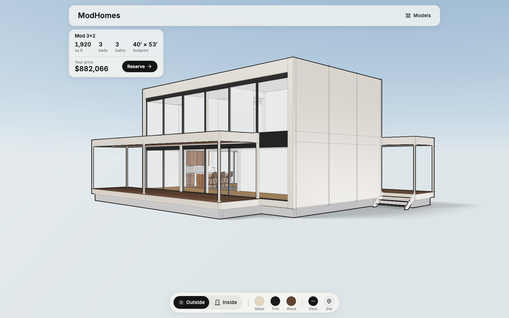
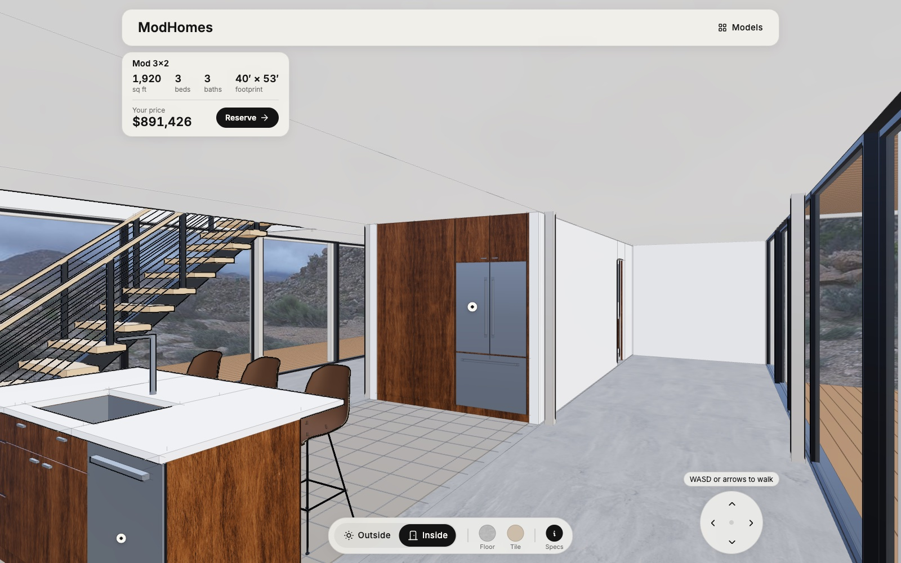
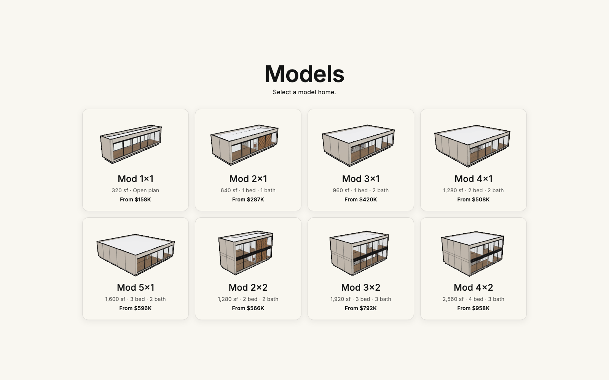
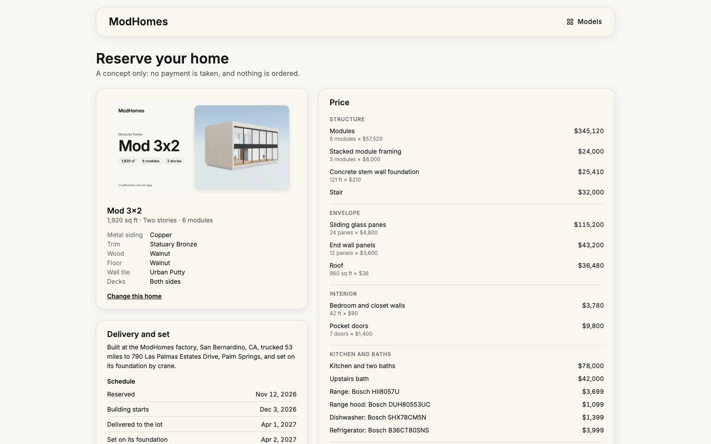

# ModHomes

**What your modular homes could look like in the browser.**

> [!IMPORTANT]
> **ModHomes is a demo for a made-up builder.** I built it to show modular home builders what's possible online. No homes are for sale. The factory, prices, delivery costs and schedules are invented, and reserving a home takes no payment and saves nothing. Imagine it with your homes.

Built by [Gavin Grant](https://www.gavingrant.com): an architect on Marmol Radziner's prefab team, then in sales at Connect Homes, and a web developer since 2020.

**[Try the live demo →](https://modhomes.vercel.app/)**

## What your buyers could do

**Configure the home in 3D.** Buyers orbit the home, pick its siding, trim and wood colors, and crane covered decks onto its glass sides. The price on the card updates with every choice, priced from what the home is built from.

**Walk through it before it's built.** They step inside and walk past the kitchen, baths, stair and bedrooms in first person. They can try floor finishes and tile colors, and tap the appliances to see their specs.

**See it on a real lot.** The Site view stands the home on Google's photorealistic 3D imagery of a lot in Palm Springs, among the neighbors' houses and trees.

**Compare every model.** The landing page shows each model turning in 3D, with its size, beds, baths and starting price.

**Reserve it.** The checkout shows the home as configured with every line of its price, delivery from the factory to the lot, the deposit, and when the home would be ready to move in.

## Try these homes

A configured home lives in its URL, so it can be shared, and a link can open it outside or straight inside. These are ready to look around:

* [Mod 3x2 in copper and walnut, with decks on both sides](https://modhomes.vercel.app/homes/mod3x2?metal=copper&wood=walnut&decks=left,right)
* [Walk through a Mod 3x2 with concrete floors, starting in its kitchen](https://modhomes.vercel.app/homes/mod3x2?floor=concrete&decks=left,right&view=inside)
* [Mod 5x1 in gray and charcoal, with concrete floors and a deck](https://modhomes.vercel.app/homes/mod5x1?metal=grey&trim=charcoal-gray&floor=concrete&tile=chalkboard&decks=right)
* [Mod 2x2 in taupe, with bamboo floors](https://modhomes.vercel.app/homes/mod2x2?metal=taupe&floor=bamboo&decks=left)
* [The checkout for the copper Mod 3x2](https://modhomes.vercel.app/homes/mod3x2/checkout?metal=copper&wood=walnut&decks=left,right)

## What it could do for your sales

* **Buyers who know the price** before they contact you.
* **A link to every configuration** that your salesperson can open, sent to your CRM as a lead.
* **Fewer surprises**, because buyers walk through the home and see its finishes before they sign.
* **A home on the buyer's own lot**, with a check that it fits.
* **A head start for the factory**, since the model that draws the home also counts what it's built from.

## Bring your homes to the browser

There are two ways we could work together. I can build this for your homes as a project, or join your team to build and run it. Either way, it would start from your plans, options, prices, factories and sales process. It can be built in phases: your homes and prices first, then your buyers' lots, then the hand-off to your factory, then the whole purchase. It sits in front of the tools you already use: your website, CRM, pricing and design models.

The live site has a short version at [modhomes.vercel.app/builders](https://modhomes.vercel.app/builders). [docs/FOR-BUILDERS.md](./docs/FOR-BUILDERS.md) covers both ways of working together, what it would take, how it fits your tools, each phase, its limits and what it costs to run.

## What this shows

If you're looking at ModHomes as an example of my work, these are the parts I'd point to:

* **Every home is generated in code.** Modules, walls, glass, stair, kitchens, baths and bedrooms are all built from layout math, with no imported 3D models. The math lives in plain functions, so it's tested without a browser. See [how a home is generated](./docs/ARCHITECTURE.md#how-a-home-is-generated).
* **The price follows the geometry.** The same functions that draw the home count what it's built from, so every pane, wall and deck is priced, and two homes with the same number of modules can cost different amounts. See [pricing](./docs/ARCHITECTURE.md#pricing).
* **It's drawn like an architect's drawing.** Light lines trace every edge, and a custom shader finds the outline against the sky in screen space. See [linework](./docs/ARCHITECTURE.md#linework).
* **It runs well on phones.** The 3D views draw only when something changes, the landing page's model cards share one WebGL canvas, and the kitchens' hundreds of parts are drawn in about a dozen draw calls. See the [performance notes](./docs/ARCHITECTURE.md#performance-notes).
* **It stands on a real lot.** The Site view settles the home onto Google's photorealistic 3D tiles of a lot in Palm Springs, and keeps the camera above the hillside around it. See the [pages](./docs/ARCHITECTURE.md#pages).
* **A configured home lives in its URL**, from the viewer to the checkout, so it can be shared or opened straight inside. See [configuration in the URL](./docs/ARCHITECTURE.md#configuration-in-the-url).
* **It's tested and documented.** About 300 unit tests, and an [architecture doc](./docs/ARCHITECTURE.md) that explains how each part works and why. It also covers which parts would change for another builder's homes.

It's built with:

* TypeScript, React and Next.js
* React Three Fiber, drei and three.js for the 3D scenes
* Material UI for the interface
* Framer Motion for animation
* Jest and React Testing Library for tests
* Vercel for hosting

## About me

I started my career as an architect, designing prefab homes on Marmol Radziner's prefab team from 2004 to 2006. From 2015 to 2018 I worked in sales at Connect Homes, which was co-founded by members of that team, helping buyers understand what a modular home would cost and take to build. In 2020 I moved into web development.

I build with AI coding tools like Claude Code, which you'll see credited in the commit history. I decide what to build and how it should work, and I own the result. The tools let me spend more of my time on what they can't do: knowing how modular homes are designed, sold and built.

ModHomes brings those together: homes designed the way a factory builds them, priced the way buyers ask about them, in a browser. There's more about me at [gavingrant.com](https://www.gavingrant.com) and on [LinkedIn](https://www.linkedin.com/in/gavinmgrant/).

## Get in touch

Whether you'd like this built for your homes, or want someone on your team who can build it, email me at [gavin@gavingrant.com](mailto:gavin@gavingrant.com).

## Running it locally

* Clone this repository to your local computer.
* Install the dependencies for the project: `yarn install`
* Run the application locally: `yarn dev`
* Open `http://localhost:3000/` in your browser.
* Run the tests: `yarn test`

### Site view (optional)

The viewer's Site switch stands a home on Google's photorealistic 3D tiles of its lot. It only appears when a Google Maps key is set. Enable the Map Tiles API on your Cloud project, then copy `.env.example` to `.env.local` and fill in `NEXT_PUBLIC_GOOGLE_MAPS_KEY` with a key for that API. The key is sent from the browser, so restrict it in the Cloud console to the site's domains and to that API, and cap the API's daily root tile set requests to stay within the free tier. The Site view section of [docs/ARCHITECTURE.md](./docs/ARCHITECTURE.md) has the details.
